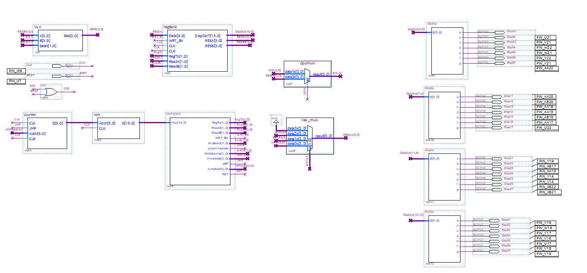
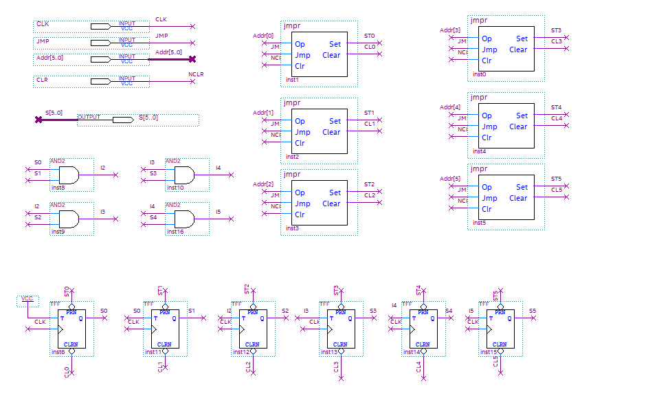
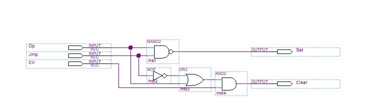
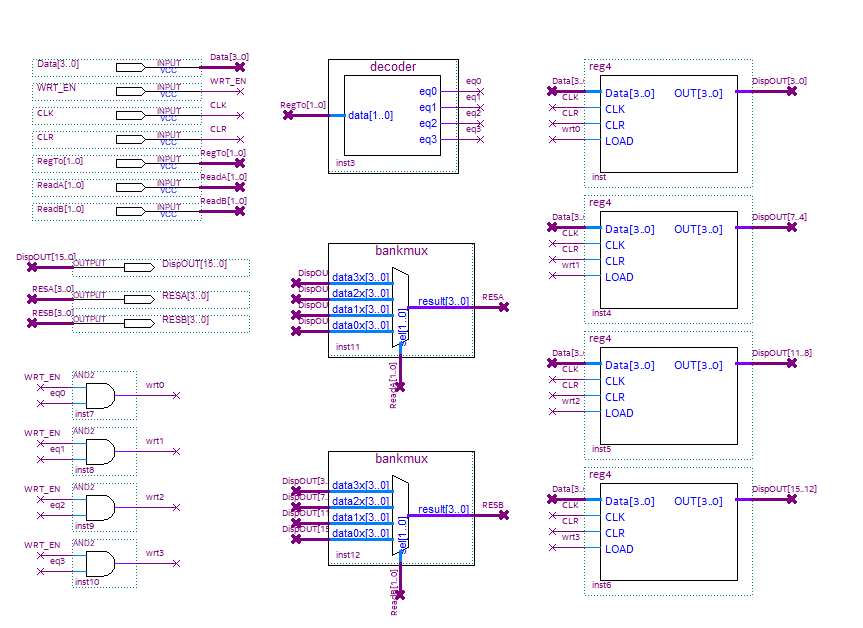
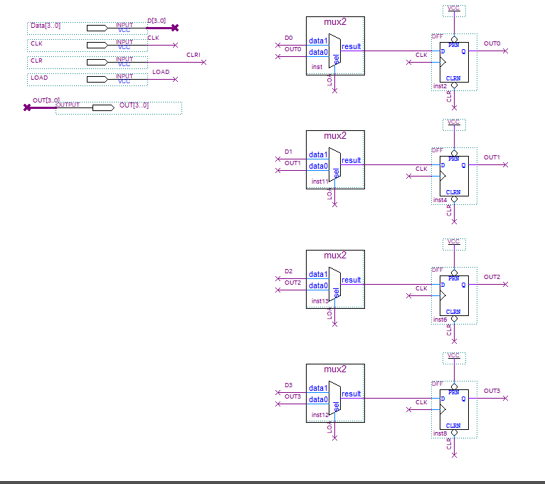
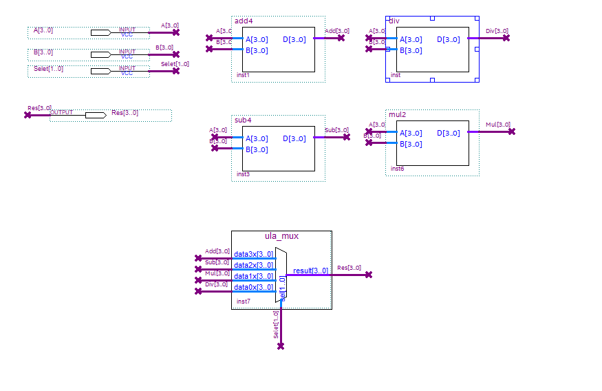
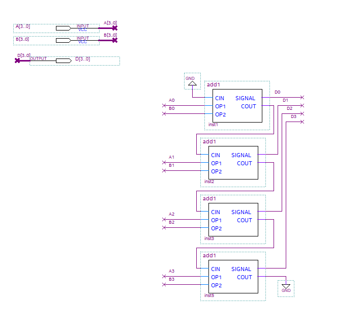
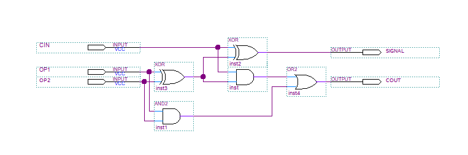

# Projeto miniCPU

**Autor:** Lucas Pereira Pacheco — 12543930
**Ambiente:** Quartus Prime Lite 24.1std.0; FPGA Cyclone V 5CEBA4F23C7.

## 1. Objetivo

O projeto consiste na construção de uma CPU didática capaz de buscar instruções em uma memória ROM, decodificá-las e realizar operações sobre um banco de registradores. Conforme o enunciado, as palavras de instrução devem ter pelo menos 16 bits, enquanto os registradores e a unidade lógica e aritmética devem possuir pelo menos 4 bits. O conteúdo dos registradores deve ser apresentado em displays após a execução das instruções.

A arquitetura desenvolvida utiliza quatro registradores de 4 bits, uma ULA de 4 bits, um contador de programa de 6 bits e uma ROM de 64 palavras de 16 bits. O conjunto decodificado inclui soma, subtração, multiplicação, divisão, movimentação de dados, salto incondicional e reinicialização. Este relatório descreve a implementação e distingue o comportamento pretendido das limitações identificadas nos arquivos disponíveis.

## 2. Arquitetura geral

*Figura 1 — Integração da ROM, contador, unidade de controle, banco de registradores, ULA e displays.*

O contador de programa fornece o endereço da instrução para a ROM. A palavra lida chega à unidade de controle, que seleciona os registradores de origem e destino, a operação aritmética e a origem do dado que será escrito. O banco disponibiliza duas saídas de leitura, RESA e RESB, e recebe um barramento de escrita de 4 bits.

O multiplexador `cpumux` escolhe entre RESB e o imediato da instrução para formar o segundo operando da ULA. O primeiro operando vem de RESA. O multiplexador `res_mux` seleciona o resultado da ULA, RESA ou o imediato para retornar ao banco. Assim, MOV e MOVI podem escrever dados sem depender de uma operação aritmética.

A saída `DispOUT[15..0]` reúne os quatro registradores: R0 ocupa os bits 3 a 0, R1 os bits 7 a 4, R2 os bits 11 a 8 e R3 os bits 15 a 12. Cada grupo de quatro bits alimenta um decodificador hexadecimal para display de sete segmentos. O arquivo `display.v` representa os valores de 0 a F com segmentos ativos em nível baixo. Seis saídas LD também estão declaradas no nível superior.

## 3. Contador de programa e salto

*Figura 2 — Contador construído com seis flip-flops T e lógica de habilitação.*

O módulo `COUNTER/counter.bdf` contém seis flip-flops T sincronizados pelo clock. O bit menos significativo alterna a cada pulso; os seguintes alternam quando todos os bits inferiores estão em nível alto. As portas AND implementam essas condições. No avanço sequencial, o contador percorre os endereços de 0 a 63, retornando a zero após o último endereço.

Cada bit também recebe sinais de preset e clear gerados por uma instância de `jmpr`. Isso permite carregar um endereço de salto nos seis bits do contador.

*Figura 3 — Circuito jmpr para um bit do endereço.*

Na figura, `Op` é o bit do endereço e `Jmp` habilita o salto. As saídas dirigem as entradas assíncronas, ativas em nível baixo, dos flip-flops. As equações implementadas são:

- `Set = NOT(Op AND Jmp)`;
- `Clear = (Op OR NOT Jmp) AND Clr`.

Com `Clr = 1` e `Jmp = 0`, as duas saídas ficam inativas. Durante um salto, um bit de endereço igual a 1 ativa o preset; um bit igual a 0 ativa o clear. O clear global deve ser aplicado com a polaridade exigida pelo circuito. Como o carregamento usa entradas assíncronas, é necessário verificar a prioridade entre salto e reset, além dos tempos de recuperação e remoção.

## 4. Banco de registradores

*Figura 4 — Banco de registradores regBank.*

O banco contém quatro instâncias de `reg4`. O campo `RegTo[1..0]` passa por um decodificador que identifica o destino. Cada saída do decodificador é combinada com `WRT_EN`, produzindo a habilitação de carga de apenas um registrador. Quando a escrita está desabilitada, todos preservam seu conteúdo.

Dois multiplexadores independentes selecionam as saídas RESA e RESB a partir de `ReadA` e `ReadB`. Dessa forma, uma instrução pode ler dois registradores e escolher um destino. A concatenação dos quatro conteúdos é exposta em `DispOUT` para visualização.

*Figura 5 — Estrutura interna de reg4.*

Cada registrador usa quatro flip-flops D. Um multiplexador por bit escolhe entre o dado externo e a própria saída do flip-flop. Com `LOAD = 1`, a entrada é carregada na borda de subida do clock; com `LOAD = 0`, a realimentação mantém o valor. As entradas de clear são compartilhadas pelos quatro bits e são ativas em nível baixo nos flip-flops mostrados.

## 5. Unidade lógica e aritmética

*Figura 6 — ULA de quatro bits.*

A ULA recebe dois operandos de 4 bits e calcula, em blocos separados, soma, subtração, multiplicação e divisão. O multiplexador `ula_mux` escolhe o resultado encaminhado à saída de 4 bits.

Há uma divergência entre a ligação apresentada no esquema e a codificação emitida pela unidade de controle:

| Select | Operação solicitada por UC.v | Entrada selecionada no esquema da ULA |
| ------ | ------------------------------ | ------------------------------------- |
| 00     | Soma                           | Divisão (`data0x`)                   |
| 01     | Subtração                    | Multiplicação (`data1x`)            |
| 10     | Multiplicação                | Subtração (`data2x`)                |
| 11     | Divisão                       | Soma (`data3x`)                       |

O módulo gerado `ula_mux.v` utiliza a seleção convencional das entradas de um LPM_MUX. Portanto, a ordem das entradas deve ser compatibilizada com `AluSelect` antes de considerar as instruções aritméticas funcionalmente validadas.

### 5.1. Somador de quatro bits

*Figura 7 — add4 formado por quatro somadores completos.*

O módulo `add4` encadeia quatro instâncias de `add1`. O carry inicial é zero, e cada estágio transmite seu carry ao próximo. Trata-se de um somador com propagação de carry, cujo atraso depende da passagem desse sinal pelos estágios. Como a saída tem quatro bits, a soma armazenada corresponde aos quatro bits menos significativos; o carry final não compõe o resultado arquitetural.

*Figura 8 — add1 implementado com portas XOR, AND e OR.*

Para os operandos A e B e o carry de entrada Cin, o somador completo implementa:

- `S = A XOR B XOR Cin`;
- `Cout = (A AND B) OR (Cin AND (A XOR B))`.

### 5.2. Demais operações e limites

Os arquivos `ULA/subtractor/sub1.bdf` e `sub4.bdf` implementam a subtração hierarquicamente. Multiplicação e divisão são descritas nos esquemas `ULA/multiplicador/mul2.bdf` e `ULA/divisor/div.bdf`. Todos apresentam interfaces externas de quatro bits.

Os dados são tratados como valores sem sinal, entre 0 e 15. A largura do caminho de dados não permite armazenar resultados maiores que quatro bits e não há flags arquiteturais de carry ou overflow na unidade de controle. A divisão por zero e o comportamento dos blocos de multiplicação e divisão nos casos extremos precisam ser verificados por simulação; não há evidência experimental desses casos no material do relatório.

## 6. Unidade de controle e formato das instruções

O módulo combinacional `UC/UC.v` extrai os campos da palavra de 16 bits da seguinte forma:

| Bits    | Campo     | Finalidade                      |
| ------- | --------- | ------------------------------- |
| 15 a 12 | opcode    | Identifica a instrução        |
| 11 a 10 | RegTo     | Registrador de destino          |
| 9 a 8   | ReadA     | Primeiro registrador de origem  |
| 7 a 6   | ReadB     | Segundo registrador de origem   |
| 3 a 0   | Immediate | Constante de quatro bits        |
| 5 a 0   | JumpAddr  | Endereço de salto de seis bits |

Immediate e JumpAddr reutilizam bits da palavra, pois pertencem a formatos diferentes de instrução. Nas operações aritméticas com imediato, os bits 5 e 4 não são usados pela unidade de controle.

A tabela abaixo documenta a semântica pretendida pelo decodificador. `Rd`, `Ra` e `Rb` representam os registradores selecionados; `imm` representa o imediato.

| Opcode hexadecimal | Instrução | Operação pretendida                 |
| ------------------ | ----------- | ------------------------------------- |
| 0                  | ADD         | Rd ← Ra + Rb                         |
| 1                  | SUB         | Rd ← Ra − Rb                        |
| 2                  | MUL         | Rd ← Ra × Rb                        |
| 3                  | DIV         | Rd ← Ra / Rb                         |
| 4                  | ADDI        | Rd ← Ra + imm                        |
| 5                  | SUBI        | Rd ← Ra − imm                       |
| 6                  | MULI        | Rd ← Ra × imm                       |
| 7                  | DIVI        | Rd ← Ra / imm                        |
| 8                  | MOV         | Rd ← Ra                              |
| 9                  | MOVI        | Rd ← imm                             |
| A                  | JMP         | Solicita salto para JumpAddr          |
| B                  | RST         | Ativa o sinal de reinicialização    |
| C a F              | Reservado   | Não habilita escrita, salto ou reset |

Nas oito instruções aritméticas, `WRT_EN` habilita a escrita. `UseImmediate` diferencia as variantes com constante. Em MOV, `WriteSource = 01` seleciona RESA; em MOVI, `WriteSource = 10` seleciona o imediato. Nas operações aritméticas, `WriteSource = 00` seleciona a ULA. O decodificador atribui valores padrão a todas as saídas do bloco combinacional.

As instruções avançadas JZ, CMP e JE mencionadas no enunciado não estão implementadas em `UC.v`.

## 7. Memória e programa de exemplo

A ROM possui 64 endereços e palavras de 16 bits, totalizando 1.024 bits de conteúdo lógico. Em `ROM/rom.bdf`, o parâmetro `LPM_FILE` referencia `microcpu_teste.mif`, presente na pasta ROM. O endereço está configurado como não registrado e a saída como registrada, com `outclock` ligado ao clock externo. Essa configuração introduz uma etapa de registro na busca; a execução não deve ser interpretada como uma busca combinacional sem latência.

O arquivo `ROM/Mif.mif` também existe, mas não é o arquivo referenciado pelo parâmetro atual da ROM.

| Endereço hexadecimal | Palavra hexadecimal | Interpretação pela UC | Resultado pretendido    |
| --------------------- | ------------------- | ----------------------- | ----------------------- |
| 00                    | 9005                | MOVI R0, 5              | R0 = 5                  |
| 01                    | 9403                | MOVI R1, 3              | R1 = 3                  |
| 02                    | 0840                | ADD R2, R0, R1          | R2 = 8                  |
| 03                    | 6D02                | MULI R3, R1, 2          | R3 = 6                  |
| 04                    | A004                | JMP 04                  | Retorno ao endereço 04 |
| 05 a 3F               | F000                | Opcode reservado        | Nenhuma escrita         |

Essa sequência pretende deixar R0 = 5, R1 = 3, R2 = 8 e R3 = 6, mantendo os valores em um laço. Esses são resultados esperados pela interpretação das instruções, não medições do circuito. A divergência na ULA, os avisos de conexão e a sincronização entre ROM, contador e escrita impedem afirmar que o hardware atual produz essa sequência corretamente.

## 8. Conclusão

O projeto reúne os principais elementos de uma CPU didática: memória de programa, contador com salto, unidade de controle, banco com duas portas de leitura, ULA e visualização dos registradores. A organização hierárquica permite relacionar os circuitos elementares, como o somador completo e o registrador de quatro bits, ao caminho de dados integrado.
